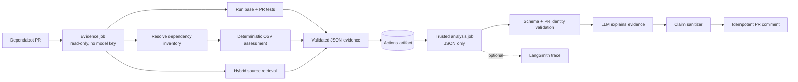
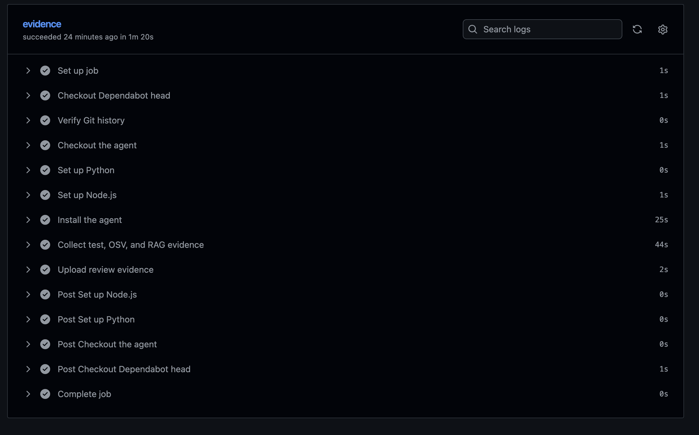
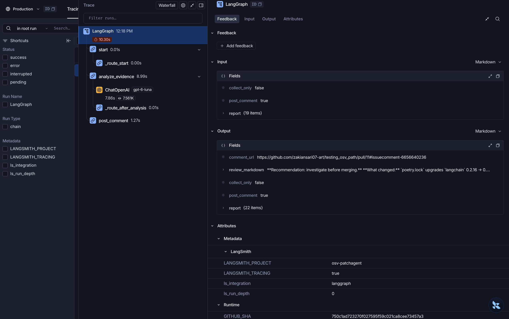

# OSV Patchpilot

**Dependabot tells you a dependency changed. OSV Patchpilot tells you what that change means — with tests, deterministic OSV assessment, source evidence, and a review comment you can audit.**

[](https://github.com/zakiansari07-art/testing_osv_patchpilot/pull/11)
[](tests/)
[](requirements.txt)
[](vulnerability_agent/validation/)
[](LICENSE)

OSV Patchpilot is a read-only reviewer for Dependabot pull requests. It checks out the exact base and PR revisions, runs both test suites, compares resolved dependencies against OSV, retrieves likely source usages, and produces a validated JSON evidence report. An LLM then explains that evidence in a compact PR comment — but it never gets to decide whether a version is vulnerable.

The review flow does not push, approve, or merge anything.

> **Try it live:** [Open the reviewed Dependabot PR #11](https://github.com/zakiansari07-art/testing_osv_patchpilot/pull/11) to read the real posted comment, or use the [public sandbox repository](https://github.com/zakiansari07-art/testing_osv_patchpilot) to run the collector yourself.

## Why this exists

Dependabot answers *“did a dependency change?”* It does not answer the questions a reviewer actually has:

- Did the update break anything? Did it fix anything?
- Which advisories are actually resolved, introduced, or still present at the installed version?
- Where is the package used in this repository — production code, tests, or not at all?
- Is the “fixed” version even compatible with the constraints in this project?

Most “AI security review” tools answer those questions with generated prose. OSV Patchpilot answers them with evidence, then lets the model explain it. Every claim in the comment traces back to a structured field in the report.

## The product in one screenshot


The comment is intentionally scannable: a deterministic verdict, the dependency changes, one test line, one OSV line, severity-ranked advisories with links, a few source clues with GitHub permalinks, and a concrete next step. The full evidence and AI narrative live behind `<details>` so the visible review stays under 2,600 characters.

The screenshot above is generated by the production renderer from a fixture report — it is not a hand-edited mockup. The same layout is live on [PR #11](https://github.com/zakiansari07-art/testing_osv_patchpilot/pull/11), and the contract is enforced by [`tests/test_comment_redesign.py`](tests/test_comment_redesign.py).

## What makes it different

| Typical dependency-review bot | OSV Patchpilot |
|---|---|
| Reports advisory counts | Evaluates OSV ranges against the **installed** version and classifies resolved / introduced / remaining / unknown |
| Trusts an LLM to summarize risk | Keeps version affectedness **deterministic**; the LLM only explains collected evidence |
| Says “used in your code” | Labels evidence as `direct_import`, `api_usage`, `test_only`, `semantic_context`, or `no_evidence` |
| Posts from the same job that runs PR code | Splits **untrusted evidence collection** from a **trusted comment job** that only reads JSON |
| Produces prose | Produces a schema-validated report with commit identity, tests, OSV deltas, and source locations |

## Architecture



The evidence job can install dependencies and execute tests from the PR snapshot, so it receives no model key and no write-capable GitHub token. The trusted `workflow_run` job checks out a pinned agent revision, downloads JSON only, validates the report against the expected repository, PR number, Dependabot author, and head SHA, then optionally posts one comment. It never checks out or executes the Dependabot branch.

## Evidence, not vibes

### Validated JSON report


Every review is archived as a schema-v6 report. Validation is more than “the JSON parses”: Pydantic models enforce field types and invariants, and cross-section checks confirm that summaries agree with the underlying dependency, test, OSV, and source-usage sections before a comment can be posted.

### Real GitHub Actions run



The evidence job in [`examples/github-actions/`](examples/github-actions/) completes dependency installation, tests, OSV scans, and source retrieval without any model credential. The companion comment job is the only place a model key is used.

### LangSmith trace



Model-backed reviews are instrumented with **LangSmith**. When `LANGSMITH_TRACING=true`, each run records the LangGraph execution, per-node latency, the model call, and the optional comment step, so slow reviews and model failures can be diagnosed without re-running the workflow. Tracing is opt-in because traces can include prompts and repository-derived text; enable it only in a workspace approved for that data.

## Engineering highlights

### 1. Deterministic security decisions, LLM narrative second

OSV range evaluation lives in `osv_service.py`. It supports `ECOSYSTEM` and `SEMVER` ranges, handles `introduced`, `fixed`, `last_affected`, and `limit` events, and **raises on unsupported or malformed evidence** rather than silently returning “not affected”. The model receives the resulting assessment and is explicitly prevented from contradicting it.

`vulnerability_agent/workflow/sanitizer.py` drops AI sentences that:

- deny an affected version assessment,
- invent source locations,
- promote test-only references to production usage,
- claim reachability that was not established,
- contradict a transitive dependency relationship,
- cite release notes that were not retrieved,
- or misstate advisory counts.

### 2. Hybrid retrieval with evidence qualification

`vulnerability_agent/retrieval/` combines:

- **AST chunking** for Python (functions, methods, class headers) and **Tree-sitter** chunking for JS/TS,
- **BM25** for exact package names, imports, and stack-trace symbols,
- **local FastEmbed vectors + Qdrant** for semantic matches,
- **reciprocal rank fusion (RRF)** to combine rankings without mixing score scales,
- and a **package-evidence gate** that refuses to return a chunk as usage evidence unless it contains a deterministic package reference.

That last point matters: dense similarity alone never promotes a file to “this package is used here”.

### 3. Trust boundary between jobs

The evidence artifact is the interface. The trusted job validates:

- report mode and schema version,
- repository, PR number, author (`dependabot[bot]`), and head SHA,
- cross-section consistency,
- artifact URL shape,
- and comment idempotency via `<!-- dependabot-ai-review -->`.

A failed validation cannot produce a comment.

### 4. Bounded by construction

Untrusted input is bounded everywhere:

| Surface | Bound |
|---|---:|
| Visible comment | 2,600 chars |
| Total comment | 12,000 chars |
| AI review | 1,800 chars |
| Review prompt | 16,000 chars |
| Source files read per finding | 60 |
| Source chars read per finding | 1.2M |
| Source locations returned | 5 |
| Source excerpt | 500 chars |
| Test process timeout | 60 s |

Truncation is explicit in the rendered output rather than silent.

### 5. Security hygiene in the collector

- Sensitive paths (`.env`, credentials, keys, tokens) are blocked by a shared policy in `vulnerability_agent/security.py`, used by the MCP gateway, reporting, and retrieval.
- Literal credential assignments are redacted before source reaches a prompt.
- Test child processes receive a reduced environment; credential variables are stripped from the parent environment while they run.
- Filesystem MCP access is read-only and policy-checked.

### 6. Refactored with guardrails, not vibes

The codebase was split from monoliths into cohesive packages while keeping compatibility shims for external callers:

- `vulnerability_agent/dependabot/` — PR metadata, snapshots, tests, inventory, OSV scans, report assembly
- `vulnerability_agent/retrieval/` — chunking, indexing, ranking, rendering
- `vulnerability_agent/validation/` — schema v6 models, consistency checks, legacy v4/v5 handling
- `vulnerability_agent/workflow/` — comment layout, formatting, verdicts, AI sanitization

[`tests/test_architecture.py`](tests/test_architecture.py) enforces **500-line files** and **80-line functions** with empty allowlists. The cleanup audit is in [`docs/CODE_CLEANUP_AUDIT.md`](docs/CODE_CLEANUP_AUDIT.md).

### 7. Optional observability with LangSmith

`main.py` records whether tracing is enabled and which LangSmith project is active in every report. With `LANGSMITH_TRACING=true`, LangGraph runs are traced end-to-end: graph nodes, latency, the model call, and the optional comment step. That makes model failures and slow reviews diagnosable without touching the deterministic evidence path. Tracing stays opt-in because traces can contain repository-derived text.

## Verification

### Test suite

```text
175 tests passed
```

The tests are offline and deterministic: GitHub, OSV, MCP, Qdrant, and model calls are faked or injected. Coverage includes:

- OSV range boundaries, malformed ranges, aliases, and deterministic classification,
- report schema and cross-section consistency,
- comment contracts (verdict, table, one test line, OSV line, advisories, permalinks, bounds),
- PR identity and idempotency checks,
- AI claim sanitization,
- secret-path blocking and redaction,
- retrieval chunking, ranking, package-evidence qualification, and persistence.

Performance is tested by **call count**, not wall-clock timing: one test asserts retrieval embeds the query once and issues exactly one dense query.

### Retrieval benchmark

The active v3 benchmark contains 28 manually labeled cases from this repository and a pinned fixture repository. Ground truth is validated against current source and AST chunks before indexing, and aggregate metrics are recomputed from stored results.

| Metric | Result |
|---|---:|
| Precision@5 | **38.52%** |
| Recall@5 | **91.52%** |
| MRR | **96.52%** |
| Scored cases | 27 (1 uncertain excluded) |
| No-evidence false positives | **0** |

Per category:

| Evidence class | Cases | Precision@5 | Recall@5 | MRR |
|---|---:|---:|---:|---:|
| `direct_import` | 4 | 80.00% | 80.43% | 100% |
| `api_usage` | 14 | 34.29% | 91.67% | 94.29% |
| `test_only` | 5 | 48.00% | 100% | 100% |
| `no_evidence` | 4 | 0.00% | — | — |

These are engineering signals on a small, hand-labeled set — not general accuracy claims. The methodology, labels, and reproduction steps are in [`evals/rag/README.md`](evals/rag/README.md).

## Quickstart

### Requirements

- Python 3.10+ and Git
- Node.js with `npx` for the MCP filesystem server
- An OpenAI API key for AI analysis or comment generation (collection-only mode does not need one)
- A GitHub token only for the GitHub operations you use

### Install

```bash
python3 -m venv .venv
source .venv/bin/activate
python -m pip install --upgrade pip
python -m pip install -r requirements.txt
```

For model-backed runs, create `.env`:

```dotenv
OPENAI_API_KEY=your-openai-api-key
OPENAI_MODEL=gpt-4o-mini
GITHUB_TOKEN=your-github-token
```

LangSmith tracing is optional: set `LANGSMITH_TRACING=true`, `LANGSMITH_API_KEY`, and optionally `LANGSMITH_PROJECT`. Traces can include repository-derived text, so use an approved workspace.

### Try the public sandbox

No repository setup required. The public [testing_osv_patchpilot](https://github.com/zakiansari07-art/testing_osv_patchpilot) repository contains real Dependabot PRs, and [PR #11](https://github.com/zakiansari07-art/testing_osv_patchpilot/pull/11) shows a completed review with the posted comment and evidence artifact.

From your OSV Patchpilot checkout:

```bash
git clone https://github.com/zakiansari07-art/testing_osv_patchpilot.git /tmp/testing_osv_patchpilot

python main.py /tmp/testing_osv_patchpilot --review-pr 11 --collect-only \
  --report /tmp/dependabot-sandbox-evidence.json
```

That collects test outcomes (when the project's runner is available), OSV results, and source clues without a model key. To preview the deterministic comment locally without posting it:

```bash
python - <<'PY'
import json
from vulnerability_agent.review_graph import render_pr_comment

report = json.load(open("/tmp/dependabot-sandbox-evidence.json"))
print(render_pr_comment(report, ""))
PY
```

Local test execution depends on the target project's toolchain. If it is unavailable, the comment says so explicitly instead of treating it as a failure; the live PR shows the CI-backed result. Add `OPENAI_API_KEY` and run `python main.py --analyze-report /tmp/dependabot-sandbox-evidence.json` to generate the AI narrative. Posting a comment requires write access to the target repository.

### 1. Collect evidence (no model key)

Use a clean clone of the repository under review:

```bash
python main.py "/path/to/clean-clone" --review-pr 123 --collect-only \
  --report "/tmp/dependabot-evidence.json"
```

### 2. Analyze and optionally post

```bash
python main.py --analyze-report "/tmp/dependabot-evidence.json" \
  --post-comment \
  --expected-pr 123 \
  --expected-repository OWNER/REPOSITORY \
  --expected-head-sha FULL_PR_HEAD_SHA
```

Reports are archived automatically under `saved report/`; `--report PATH` writes an additional copy. See `python main.py --help`.

### 3. Run the tests and benchmark

```bash
python -m pytest -q
python evals/rag/evaluate.py /tmp/patchpilot-rag-v3.json
```

The first evaluation run may download the FastEmbed model; after that it is local. The evaluator does not call OSV, an LLM, or a live search service.

## Repository map

| Area | Paths | Responsibility |
|---|---|---|
| CLI and orchestration | `main.py`, `vulnerability_agent/review_graph.py` | Collection, analysis, report saving, optional comment |
| Dependency evidence | `vulnerability_agent/dependabot/`, `osv_service.py` | PR metadata, snapshots, tests, inventory, OSV delta, report assembly |
| Source evidence | `vulnerability_agent/nodes/usage_analysis.py`, `vulnerability_agent/retrieval/`, `vulnerability_agent/package_imports.py` | Package mapping, hybrid retrieval, evidence classification |
| Validation | `vulnerability_agent/validation/` | Schema v6 models, consistency checks, legacy normalization |
| Comment | `vulnerability_agent/workflow/` | Verdict, layout, formatting, AI sanitization |
| Trust and safety | `vulnerability_agent/security.py`, `reporting.py`, `mcp_client.py`, `sandbox_runner.py` | Secret policy, redaction, read-only MCP, reduced test environment |
| Verification | `tests/`, `evals/rag/` | Offline regression/security tests and versioned retrieval benchmark |
| CI templates | `examples/github-actions/` | Evidence/comment job split with pinned agent revision |

`vulnerability_agent/dependabot_review.py` and `vulnerability_agent/report_validation.py` remain as thin compatibility shims for external callers; internal code imports the new packages directly.

## Design decisions and tradeoffs

- **Deterministic first, model second.** The LLM is a technical writer, not an oracle. Tradeoff: less fluent prose, far fewer unsupported security claims.
- **Artifact handoff instead of one job.** The untrusted job never holds a write token or model key. Tradeoff: two jobs and one artifact round-trip.
- **Local-first retrieval.** Qdrant and FastEmbed keep repository code on the machine. Tradeoff: first-run model download and index build cost.
- **Strict validation before comment posting.** A malformed or mismatched report fails closed. Tradeoff: more plumbing and explicit identity flags.
- **Additive schema evolution.** Schema v6 adds `summary.verdict`, `highlights`, and `next_step` while retaining the verbose `summary.recommendation` for JSON back-compat. Legacy v4/v5 handling is isolated in `validation/legacy.py`.
- **Bounded prompts and comments.** Truncation is visible and testable. Tradeoff: extremely large PRs lose detail in the comment, but the JSON report remains complete.

## Limitations

- The agent reviews dependency changes; it does not modify or merge the Dependabot PR.
- OSV coverage depends on supported manifests, resolved versions, and OSV data. An incomplete scan is not evidence that a repository is vulnerability-free.
- Test execution is best-effort and not an OS-level sandbox. Use ephemeral runners for untrusted dependency code.
- Retrieval can miss or mis-rank locations. A source clue does not prove that vulnerable behavior is reachable at runtime.
- The GitHub Actions files are templates: pin every third-party Action to a verified commit SHA and review token permissions before production use.

## License

MIT — see [`LICENSE`](LICENSE).
