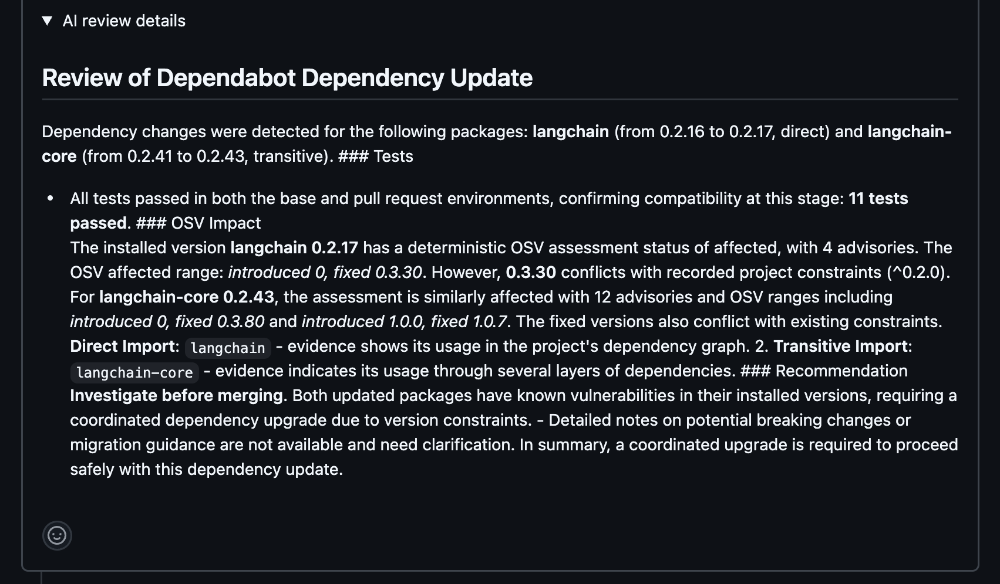
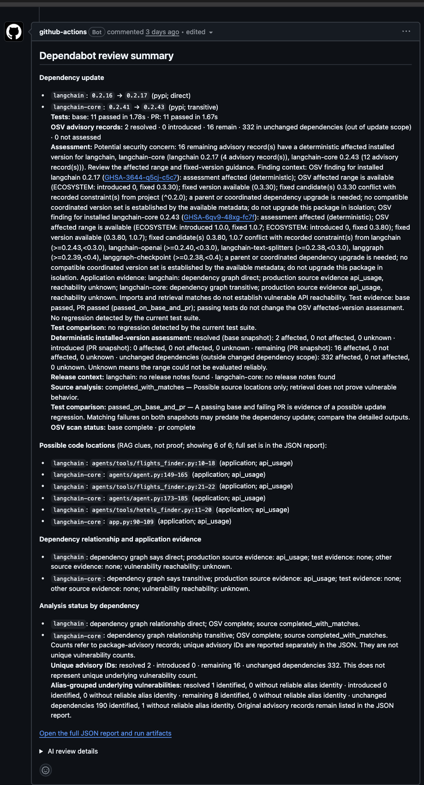
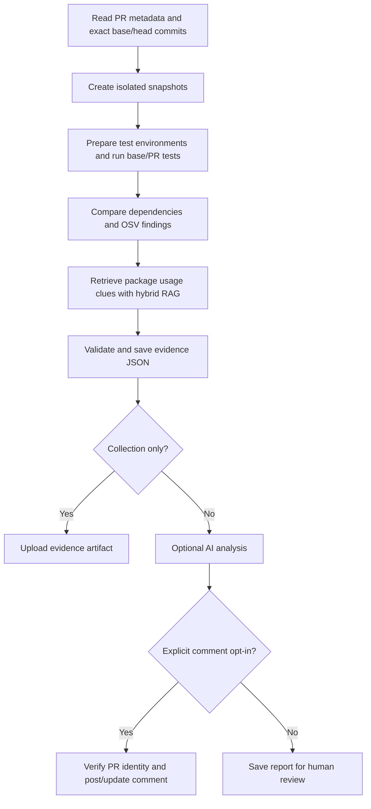

# OSV Patchpilot

**A Dependabot pull request review agent that turns dependency changes into test-backed, traceable security evidence.**

OSV Patchpilot collects evidence about an open Dependabot PR, compares dependency and OSV results between the base and updated revisions, and produces a validated report. It can optionally use an LLM to explain the evidence and post one concise comment. The review flow is read-only with respect to the PR: it does not push, edit, approve, or merge it.

## Project at a glance

| | |
|---|---|
| **Language** | Python |
| **Workflow orchestration** | LangGraph |
| **Security data** | Google OSV API and deterministic advisory/version comparison |
| **Source evidence** | Qdrant, FastEmbed, BM25, dense retrieval, RRF, AST/Tree-sitter chunks |
| **Integrations** | GitHub API, read-only MCP filesystem access, OpenAI, optional LangSmith tracing |
| **Automation** | Separate GitHub Actions evidence and trusted comment workflows |
| **Current verification** | Full test suite and versioned retrieval evaluation; see below |

## What this project demonstrates

- **Secure CI design:** separate a job that executes dependency setup and tests from a trusted job that analyzes the artifact and may write a PR comment.
- **Evidence-oriented AI:** gather exact commits, test outcomes, dependency changes, OSV findings, and labeled source clues before asking a model to summarize.
- **Deterministic security logic:** classify advisory changes and validate report consistency in code; use the LLM for explanation, not authoritative vulnerability decisions.
- **Hybrid code search:** combine lexical and vector retrieval, then qualify package evidence using import and source metadata. Preserve file, line, symbol, and evidence type for review.
- **Defensive reporting:** validate downloaded JSON, verify PR number/repository/author/head SHA before commenting, redact likely credentials, and retain provenance.
- **Testable integration boundaries:** OSV, GitHub, MCP, and model calls are isolated behind functions or injected clients and covered by offline tests.

## Demo gallery

The repository does not include captured UI screenshots or a LangSmith trace yet. Replace these placeholders with real, sanitized captures before sharing the project. Remove secrets and private repository data from images and recordings.

| Demo asset | Suggested capture | Suggested file |
|---|---|---|
| LangSmith trace GIF | Review graph nodes from collection through analysis, with sensitive values hidden. | `docs/assets/langsmith-review-trace.gif` |
| Review report | Summary of base/PR tests, OSV delta, and labeled source locations. | `docs/assets/dependabot-review-report.png` |
| GitHub comment | Final concise comment with evidence-artifact link and collapsed AI assessment. | `docs/assets/dependabot-review-comment.png` |
| Actions handoff | Evidence artifact produced by the first workflow and consumed by the trusted comment workflow. | `docs/assets/github-action-evidence-workflow` |
| Actions handoff | Comment artifact produced by the first workflow and consumed by the trusted comment workflow. | `docs/assets/github-action-evidence-workflow` |

<!-- Replace the comments below with image links after adding reviewed captures. -->

<!--  -->

<!--  -->

<!--  -->

<!--  -->

## Review workflow



### Trust boundaries

The evidence workflow can install dependencies and run tests from the PR snapshot. It receives no OpenAI key or write-capable GitHub token. The separate `workflow_run` comment workflow checks out trusted agent code, downloads JSON evidence only, validates the report against the event’s PR identity, and posts a comment only when explicitly configured. It does not check out or execute the Dependabot branch.

The local CLI also separates collection from commenting: `--collect-only` gathers evidence without calling an LLM; `--analyze-report --post-comment` consumes a saved report and requires expected PR identity values.

## Retrieval evaluation

The active v3 benchmark is focused on the review product and contains 28 labeled cases from this repository and a pinned fixture repository. It excludes the retired remediation graph and Git MCP configuration. The frozen v2 dataset, baseline, and results remain as historical artifacts; v2 is no longer the active benchmark because it labels source locations that have since been removed.

| Metric | Active review-focused v3 |
|---|---:|
| Precision@5 | 40.74% |
| Recall@5 | 94.42% |
| MRR | 100% |

Metrics are macro-averaged under the evaluator definitions and are engineering signals on a small, manually labeled set—not general accuracy claims. See [`evals/rag/README.md`](evals/rag/README.md) for methodology and reproduction.

## Run locally

### Requirements

- Python 3.10 or newer and Git.
- Node.js with `npx` for the MCP filesystem server.
- An OpenAI API key for AI analysis or comment generation. Collection-only mode does not need it.
- A GitHub token only for the GitHub operations being used.

### Install

```bash
python3 -m venv .venv
source .venv/bin/activate
python -m pip install --upgrade pip
python -m pip install -r requirements.txt
```

For model-backed runs, create a local `.env` file:

```dotenv
OPENAI_API_KEY=your-openai-api-key
OPENAI_MODEL=gpt-4o-mini
GITHUB_TOKEN=your-github-token
```

LangSmith is optional. Enable tracing with `LANGSMITH_TRACING=true`, `LANGSMITH_API_KEY`, and optionally `LANGSMITH_PROJECT`. Traces can include repository-derived text and prompts, so use a workspace approved for that data.

### Collect a local review

Use a clean clone of the repository under review:

```bash
python main.py "/path/to/clean-clone" --review-pr 123 --collect-only \
  --report "/tmp/dependabot-evidence.json"
```

Analyze a collected report and optionally post a comment:

```bash
python main.py --analyze-report "/tmp/dependabot-evidence.json" \
  --post-comment \
  --expected-pr 123 \
  --expected-repository OWNER/REPOSITORY \
  --expected-head-sha FULL_PR_HEAD_SHA
```

See all options with `python main.py --help`. Reports are automatically archived under `saved report/`; use `--report PATH` for an additional copy.

## Tests and evaluation

Run the full suite:

```bash
python -m pytest -q
```

Run the active retrieval evaluation to a separate file:

```bash
python evals/rag/evaluate.py /tmp/patchpilot-rag-v3.json
```

The tests mock OSV, GitHub, MCP, and model calls. The RAG evaluator uses a temporary local Qdrant index and FastEmbed; the model may need to be downloaded on its first run.

## GitHub Actions templates

The templates in [`examples/github-actions/`](examples/github-actions/) illustrate the evidence/comment split. Configure `VULNERABILITY_AGENT_REPOSITORY` and `VULNERABILITY_AGENT_COMMIT` to a reviewed immutable agent commit, then add the required secrets. Before using the examples in another repository, pin all third-party Actions to verified commit SHAs and review token permissions. More setup detail is in [`docs/DEPENDABOT_REVIEW.md`](docs/DEPENDABOT_REVIEW.md).

For a code-oriented introduction to the current review flow and architecture, see the [Beginner Study Guide](docs/BEGINNER_STUDY_GUIDE.md).

## Repository map

| Area | Files | Responsibility |
|---|---|---|
| CLI and review graph | `main.py`, `vulnerability_agent/review_graph.py` | Collection, analysis, report saving, optional comment |
| Dependency evidence | `vulnerability_agent/dependabot_review.py`, `osv_service.py` | Snapshot comparison, test execution, dependency resolution, OSV delta |
| Source evidence | `vulnerability_agent/nodes/usage_analysis.py`, `vulnerability_agent/retrieval.py`, `vulnerability_agent/package_imports.py` | Package mapping and hybrid code retrieval |
| Trust and reporting | `mcp_client.py`, `reporting.py`, `vulnerability_agent/report_validation.py` | Read-only tool policy, redaction, report validation |
| Verification | `tests/`, `evals/rag/` | Regression/security tests and versioned retrieval benchmark |

## Limitations

- The agent reviews dependency changes; it does not modify or merge the Dependabot PR.
- OSV coverage depends on supported manifests, resolved package versions, and the data returned by OSV. An incomplete scan is not evidence that a repository is vulnerability-free.
- Test execution is best-effort and not an OS-level sandbox. Use ephemeral runners for untrusted dependency code.
- RAG may miss or mis-rank locations. A source reference does not prove that vulnerable behavior is reachable at runtime.
- The GitHub Actions files are examples and should be pinned and reviewed before production use.
