# OSV Patchpilot

**A human-approved dependency security agent that turns OSV findings and Dependabot updates into reviewable, test-backed evidence.**

OSV Patchpilot is a Python portfolio project exploring a practical question: how can an AI workflow help with dependency security while keeping security decisions, code changes, and GitHub permissions under human control?

It has two workflows:

1. **Remediate a vulnerable dependency:** inspect resolved versions, query OSV, propose a dependency-only update, regenerate supported lockfiles, run tests, verify the advisory again, and pause for approval before creating a branch and pull request.
2. **Review a Dependabot pull request:** compare base and PR snapshots, test outcomes, OSV findings, and package usage clues; produce a validated JSON report and optionally post a concise comment.

This is an educational portfolio project, not a production security service. It does not merge pull requests or claim that a dependency is exploitable or safe based on AI output.

## Project at a glance

| | |
|---|---|
| **Language** | Python |
| **Workflow orchestration** | LangGraph with resumable SQLite checkpoints |
| **Security data** | Google OSV API; deterministic package/version and advisory matching |
| **Code retrieval** | Qdrant, FastEmbed, BM25, dense retrieval, Reciprocal Rank Fusion, AST/Tree-sitter chunks |
| **Integrations** | GitHub API, MCP filesystem/Git tools, OpenAI, optional LangSmith tracing |
| **Automation** | Two GitHub Actions examples with separate evidence and comment jobs |
| **Current verification** | 209 tests passing; evaluation v2 covers 30 labeled cases |

## What this project demonstrates

- **Agent workflow design:** explicit graph nodes, conditional transitions, bounded retries, per-finding worktrees, resumable approval checkpoints, and failure reporting.
- **Security-minded AI integration:** the model proposes small dependency-file edits; deterministic validation restricts edited paths and exact replacements. OSV range checks, tests, and a post-change scan provide independent checks.
- **Evidence-first reporting:** package-advisory provenance, test comparisons, source locations, and report validation stay visible in versioned JSON.
- **Hybrid code retrieval:** syntax-aware chunks combine keyword and vector search. Package/import metadata qualifies results, while test-only and semantic-context evidence stay labeled.
- **CI trust boundaries:** an evidence job can execute dependency installation and tests without AI or write secrets. A separate trusted job consumes a validated artifact and can post a comment without checking out or executing the Dependabot branch.
- **Engineering discipline:** tests cover graph routing, parsing, security guardrails, report contracts, retrieval, and regressions.

## Demo gallery

The repository does not currently include captured UI screenshots or a LangSmith trace recording. Add real captures here when available; keep credentials, private repository contents, and API keys out of images and recordings.

| Demo asset | What to capture | Suggested file |
|---|---|---|
| LangSmith trace GIF | A short trace showing graph nodes, transitions, and a completed run with secrets and repository details hidden. | `docs/assets/langsmith-trace.gif` |
| Dependabot review report | The generated summary showing base/PR test results, OSV delta, and labeled source locations. | `docs/assets/dependabot-review-report.png` |
| Human approval checkpoint | The CLI paused before publishing a branch or pull request. | `docs/assets/approval-checkpoint.png` |
| GitHub Actions handoff | The evidence artifact flowing into the trusted comment workflow. | `docs/assets/actions-handoff.png` |

<!-- Replace each placeholder below with the corresponding image after adding a reviewed capture. -->

<!--  -->

<!--  -->

<!--  -->

<!--  -->

## How it works

```mermaid
flowchart TD
  subgraph Remediation[OSV remediation]
    A[Resolve manifests and lockfiles] --> B[Query OSV and group findings]
    B --> C[Create isolated worktree]
    C --> D[Run baseline tests]
    D --> E[Model proposes dependency-file edits]
    E --> F[Validate edits and regenerate lockfile]
    F --> G[Run tests and rescan OSV]
    G --> H{Verified and approved?}
    H -- No --> I[Record failure or await approval]
    H -- Yes --> J[Create branch and pull request]
  end

  subgraph Review[Dependabot review]
    K[Read PR metadata and exact commits] --> L[Test base and PR snapshots]
    L --> M[Compare OSV and dependency changes]
    M --> N[Retrieve labeled package usage clues]
    N --> O[Validate evidence JSON]
    O --> P[Optional AI assessment and PR comment]
  end
```



### Key design choices

- **Deterministic security checks:** the model explains evidence and proposes edits. Package identity, version ranges, advisory status, allowed edit paths, and report consistency are checked in code.
- **Small, constrained patches:** the remediation model returns exact search/replace edits. Application source and tests are outside the allowed patch paths; generated Python lockfiles are regenerated by the package manager.
- **Human approval before publishing:** a verified change pauses at a resumable checkpoint. Approval can authorize a branch and PR; it never merges the PR.
- **RAG is navigation evidence:** retrieval finds likely usage locations. It does not establish vulnerable-call reachability and is not included in the patch prompt.
- **Separate CI trust zones:** the evidence workflow has no OpenAI or write-capable token. The comment workflow checks out trusted agent code and validates the downloaded evidence against PR identity.

## Retrieval evaluation

The versioned v2 benchmark contains **30 labeled cases** covering API use, direct imports, test-only references, configuration-only evidence, semantic context, and no-evidence cases. On the saved package-aware update, compared with the frozen v2 baseline:

| Metric | Baseline | Updated |
|---|---:|---:|
| Precision@5 | 39.29% | **41.43%** |
| Recall@5 | 87.88% | **92.57%** |
| MRR | 93.06% | **100.00%** |
| No-evidence false-positive results | 20 | **0** |

Precision, recall, and MRR are macro-averaged according to the evaluator’s v2 definitions. These are results on a small, manually labeled benchmark, not a claim of general retrieval accuracy. See [`evals/rag/README.md`](evals/rag/README.md) for the metric definitions and reproduction instructions; the frozen labels and baseline remain unchanged.

## Run locally

### Requirements

- Python 3.10 or newer and Git.
- Node.js/`npx` and `uv`/`uvx` for the configured MCP servers.
- Poetry or `uv` when a target project needs a Python lockfile regenerated.
- An OpenAI API key for model planning or AI review. Evidence collection can run without it.
- A GitHub token only for the GitHub operations being used.

### Install

```bash
python3 -m venv .venv
source .venv/bin/activate
python -m pip install --upgrade pip
python -m pip install -r requirements.txt
```

For model-backed runs, create a local `.env` file in the project root:

```dotenv
OPENAI_API_KEY=your-openai-api-key
OPENAI_MODEL=gpt-4o-mini
GITHUB_TOKEN=your-github-token
```

`OPENAI_MODEL` and `GITHUB_TOKEN` are only needed for paths that use them. LangSmith is optional; enable tracing with `LANGSMITH_TRACING=true`, `LANGSMITH_API_KEY`, and optionally `LANGSMITH_PROJECT`. Traces can contain repository-derived text and prompts, so use a workspace approved for that data.

### Try the CLI

```bash
python main.py --help
```

Run an OSV remediation against a clean, disposable repository clone:

```bash
python main.py "/path/to/clean-repository" --report "/tmp/patchpilot-run.json"
```

Review a Dependabot pull request locally without posting a comment:

```bash
python main.py "/path/to/clean-clone" --review-pr 123 --collect-only \
  --report "/tmp/dependabot-evidence.json"
```

The collected report can be analyzed separately. Posting requires an explicit opt-in and expected PR identity values:

```bash
python main.py --analyze-report "/tmp/dependabot-evidence.json" \
  --post-comment \
  --expected-pr 123 \
  --expected-repository OWNER/REPOSITORY \
  --expected-head-sha FULL_PR_HEAD_SHA
```

## Tests and evaluation

Run the full suite:

```bash
python -m pytest -q
```

Re-run RAG evaluation to a separate output file; this preserves the frozen baseline and saved historical results:

```bash
python evals/rag/evaluate.py /tmp/patchpilot-rag-results.json
```

The test suite mocks OSV, GitHub, MCP, and model calls. It does not create a real pull request or require API keys. The RAG evaluation uses the local embedding model and a temporary Qdrant index; its first run may require downloading the model.

## GitHub Actions example

The templates in [`examples/github-actions/`](examples/github-actions/) show an evidence job followed by a trusted comment job. To adapt them, copy both files into a target repository's `.github/workflows/`, set `VULNERABILITY_AGENT_REPOSITORY` and `VULNERABILITY_AGENT_COMMIT` to a reviewed immutable agent commit, and configure the required secrets. Review and pin all third-party Actions to verified commit SHAs before production use. More setup detail is in [`docs/DEPENDABOT_REVIEW.md`](docs/DEPENDABOT_REVIEW.md).

## Repository map

| Area | Files | Responsibility |
|---|---|---|
| CLI and orchestration | `main.py`, `vulnerability_agent/graph.py`, `vulnerability_agent/review_graph.py` | CLI, remediation graph, review graph, approval/resume paths |
| Security analysis | `osv_service.py`, `vulnerability_agent/dependabot_review.py`, `vulnerability_agent/report_validation.py` | Dependency resolution, OSV comparison, evidence/report validation |
| Retrieval | `vulnerability_agent/retrieval.py`, `vulnerability_agent/package_imports.py`, `vulnerability_agent/nodes/usage_analysis.py` | Hybrid search, package mappings, source evidence |
| Integrations and safety | `mcp_client.py`, `sandbox_runner.py`, `persistence.py`, `examples/github-actions/` | Tool policy, test subprocesses, checkpoints, CI handoff |
| Verification | `tests/`, `evals/rag/` | Regression/security tests and versioned retrieval benchmark |

## Current limitations

- The project updates dependency declarations and supported lockfiles; it does not repair vulnerable application code.
- A clean OSV result is bounded by supported manifest formats, resolved versions, and OSV data. It is not proof that a repository is vulnerability-free.
- Test execution is best-effort and is not an OS-level sandbox. Use disposable repositories and ephemeral CI runners for untrusted dependency code.
- RAG can miss or mis-rank locations. A source reference does not prove that vulnerable code is reachable at runtime.
- The Actions files are examples. Pin every action and review token permissions and repository settings before adopting them.

## About this portfolio project

This project is designed to make engineering decisions inspectable: graph state and transitions are explicit, proposed changes are constrained, reports retain evidence provenance, tests cover security boundaries, and evaluation inputs are versioned. The demo assets above are placeholders until real, sanitized captures are added.
