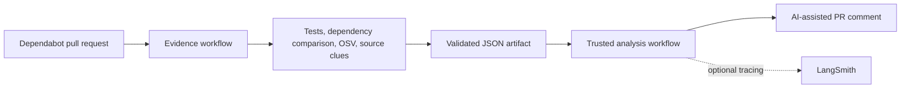

# OSV Patchpilot

**A Dependabot pull request reviewer that turns dependency updates into test-backed, traceable security evidence.**

OSV Patchpilot compares the base and updated revisions, runs their tests, checks dependency versions against OSV, and retrieves source-usage clues. It produces a validated JSON report and can use an LLM to explain the evidence in a concise pull request comment. The review flow does not push changes, approve, or merge the PR.

> **The product in one view:** evidence is collected in GitHub Actions, passed as a JSON artifact to a trusted workflow, then summarized in a review comment. The comment links back to the full report.

## Product walkthrough

The screenshots and recording below are placeholders for sanitized captures. Add the media under `docs/assets/` and uncomment or replace the corresponding Markdown when ready. Use a public or synthetic repository, and remove tokens, private source, usernames, and other sensitive details before publishing.

### 1. Dependabot review comment

Lead with the user-facing result: show the dependency change, base/PR test outcomes, OSV delta, source clues, artifact link, and expandable AI assessment.

<!-- Add docs/assets/dependabot-review-comment.png -->
<!--  -->

### 2. Structured JSON evidence report

Show a readable report excerpt or editor screenshot that makes the evidence and provenance visible. Keep it focused on the summary, dependency changes, OSV results, tests, and source-usage sections.

<!-- Add docs/assets/dependabot-review-report.png -->
<!--  -->

### 3. LangSmith trace

A short GIF can show the analysis run and its trace details. Hide prompt content or repository-derived text that should not be public.

<!-- Add docs/assets/langsmith-review-trace.gif -->
<!--  -->

### 4. Short demo video (optional)

Aim for 30–60 seconds: open the Dependabot PR, show the Actions evidence run and report, reveal the posted comment, then show the corresponding LangSmith trace. Add captions so the demo works without audio. Keep the README useful without the video; upload it to GitHub or another shareable host and link it here.

<!-- Replace with a GitHub video URL after publishing the sanitized demo. -->
<!-- [Watch the 45-second OSV Patchpilot demo](https://github.com/OWNER/REPOSITORY/assets/VIDEO_ID) -->

## How the review works



The evidence workflow can install dependencies and run tests from the PR snapshot. It receives no OpenAI key or write-capable GitHub token. A separate trusted `workflow_run` job checks out the reviewed agent revision, downloads JSON evidence only, validates it against the PR identity, and posts a comment only when configured. It never checks out or executes the Dependabot branch.

## Technical highlights

- **Security decisions stay deterministic:** code compares OSV advisory and affected-version data; the LLM explains the collected evidence rather than deciding whether a version is vulnerable.
- **Hybrid source retrieval:** BM25 and dense search are fused with reciprocal rank fusion (RRF), then package/import and source metadata help qualify code locations.
- **Evidence remains inspectable:** reports preserve commit identity, test results, dependency changes, OSV deltas, and labeled source locations.
- **The comment path is guarded:** downloaded JSON is validated, PR number/repository/author/head SHA are checked, and likely credentials are redacted.
- **Observability is optional:** LangSmith can trace model-backed analysis when configured.
- **Integration boundaries are testable:** GitHub, OSV, MCP, and model calls are covered by offline tests.

## Technology stack

| Area | Technologies | Role |
|---|---|---|
| Language and orchestration | Python, LangGraph | Review pipeline and report analysis |
| Security intelligence | Google OSV API | Advisory and affected-version evidence |
| Retrieval | Qdrant, FastEmbed, BM25, dense retrieval, RRF, AST/Tree-sitter chunks | Find and qualify package usage clues |
| Automation and integrations | GitHub Actions, GitHub API, read-only MCP filesystem access | Collect evidence and hand it to the trusted comment workflow |
| AI and observability | OpenAI, optional LangSmith | Explain evidence and trace model-backed runs |

## Retrieval evaluation

The active v3 benchmark is focused on the review product and contains 28 labeled cases from this repository and a pinned fixture repository. It excludes the retired remediation graph and Git MCP configuration. The frozen v2 dataset, baseline, and results remain as historical artifacts; v2 is no longer the active benchmark because it labels source locations that have since been removed.

| Metric | Active review-focused v3 |
|---|---:|
| Precision@5 | 40.74% |
| Recall@5 | 94.42% |
| MRR | 100% |

Metrics are macro-averaged under the evaluator definitions and are engineering signals on a small, manually labeled set—not general accuracy claims. See [`evals/rag/README.md`](evals/rag/README.md) for methodology and reproduction.

## Run locally

### Requirements

- Python 3.10 or newer and Git.
- Node.js with `npx` for the MCP filesystem server.
- An OpenAI API key for AI analysis or comment generation. Collection-only mode does not need it.
- A GitHub token only for the GitHub operations being used.

### Install

```bash
python3 -m venv .venv
source .venv/bin/activate
python -m pip install --upgrade pip
python -m pip install -r requirements.txt
```

For model-backed runs, create a local `.env` file:

```dotenv
OPENAI_API_KEY=your-openai-api-key
OPENAI_MODEL=gpt-4o-mini
GITHUB_TOKEN=your-github-token
```

LangSmith is optional. Enable tracing with `LANGSMITH_TRACING=true`, `LANGSMITH_API_KEY`, and optionally `LANGSMITH_PROJECT`. Traces can include repository-derived text and prompts, so use a workspace approved for that data.

### Collect a local review

Use a clean clone of the repository under review:

```bash
python main.py "/path/to/clean-clone" --review-pr 123 --collect-only \
  --report "/tmp/dependabot-evidence.json"
```

Analyze a collected report and optionally post a comment:

```bash
python main.py --analyze-report "/tmp/dependabot-evidence.json" \
  --post-comment \
  --expected-pr 123 \
  --expected-repository OWNER/REPOSITORY \
  --expected-head-sha FULL_PR_HEAD_SHA
```

See all options with `python main.py --help`. Reports are automatically archived under `saved report/`; use `--report PATH` for an additional copy.

## Tests and evaluation

Run the full suite:

```bash
python -m pytest -q
```

Run the active retrieval evaluation to a separate file:

```bash
python evals/rag/evaluate.py /tmp/patchpilot-rag-v3.json
```

The tests mock OSV, GitHub, MCP, and model calls. The RAG evaluator uses a temporary local Qdrant index and FastEmbed; the model may need to be downloaded on its first run.

## GitHub Actions templates

The templates in [`examples/github-actions/`](examples/github-actions/) illustrate the evidence/comment split. Configure `VULNERABILITY_AGENT_REPOSITORY` and `VULNERABILITY_AGENT_COMMIT` to a reviewed immutable agent commit, then add the required secrets. Before using the examples in another repository, pin all third-party Actions to verified commit SHAs and review token permissions. More setup detail is in [`docs/DEPENDABOT_REVIEW.md`](docs/DEPENDABOT_REVIEW.md).

For a code-oriented introduction to the current review flow and architecture, see the [Beginner Study Guide](docs/BEGINNER_STUDY_GUIDE.md).

## Repository map

| Area | Files | Responsibility |
|---|---|---|
| CLI and review graph | `main.py`, `vulnerability_agent/review_graph.py` | Collection, analysis, report saving, optional comment |
| Dependency evidence | `vulnerability_agent/dependabot_review.py`, `osv_service.py` | Snapshot comparison, test execution, dependency resolution, OSV delta |
| Source evidence | `vulnerability_agent/nodes/usage_analysis.py`, `vulnerability_agent/retrieval.py`, `vulnerability_agent/package_imports.py` | Package mapping and hybrid code retrieval |
| Trust and reporting | `mcp_client.py`, `reporting.py`, `vulnerability_agent/report_validation.py` | Read-only tool policy, redaction, report validation |
| Verification | `tests/`, `evals/rag/` | Regression/security tests and versioned retrieval benchmark |

## Limitations

- The agent reviews dependency changes; it does not modify or merge the Dependabot PR.
- OSV coverage depends on supported manifests, resolved package versions, and the data returned by OSV. An incomplete scan is not evidence that a repository is vulnerability-free.
- Test execution is best-effort and not an OS-level sandbox. Use ephemeral runners for untrusted dependency code.
- RAG may miss or mis-rank locations. A source reference does not prove that vulnerable behavior is reachable at runtime.
- The GitHub Actions files are examples and should be pinned and reviewed before production use.
